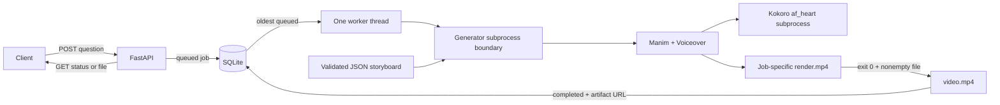

# How the prototype works

The API is the public boundary; drawing a scene is an implementation detail of a job.
`POST /videos` validates one exact question, commits a queued record to SQLite, wakes
the worker and returns HTTP 202. Rendering does not run inside the request handler.



## State and queue

`app/jobs.py` opens short-lived SQLite connections. An increasing database sequence
provides FIFO order, and `BEGIN IMMEDIATE` makes claiming the oldest queued job and
marking it processing one transaction. The database itself is the queue; the thread's
event is only a wake-up signal. `app/worker.py` supervises one render at a time and
records completed or failed status.

On exclusive application startup, processing rows from an interrupted run become failed;
queued rows are processed normally. This prevents silent duplicate work. The policy
assumes a single application process. Starting a second instance against the same database
could incorrectly fail active jobs, so multi-worker Uvicorn is unsupported.

## Generation and publication

`app/generator.py` checks the canonical UUID, loads the registered storyboard, verifies
its question, and creates a fresh job directory. It writes a scenario snapshot, then
invokes the fixed Manim entry point using an argument list rather than a shell command.
Clients cannot choose Python files, classes or filesystem paths.

`scenes/intro.py` loads the snapshot. The Pydantic schema rejects mismatched concepts,
questions, ordered visual identifiers, duplicate segment IDs and unknown fields.
`scenes/ph.py` and `scenes/bonding.py` provide explicit animation functions;
`scenes/style.py` shares colors, labels, cards, atom/electron symbols and molecule models.
There is no generic JSON-to-animation interpreter or runtime science authoring model.

Narration remains in JSON. Each complete sentence is one cue; the corresponding handler
expects a specific number of cues and the tests check that all are consumed in order.
`scenes/speech.py` starts `.venv-tts/Scripts/python.exe` once to synthesize every sentence
through `app/synthesize.py`. Kokoro loads once per job, with voice `af_heart`. WAV files
are newly written in the job's media cache, and Voiceover uses their durations to time
each action. This is synthesis and playback timing, not an automated audio-quality review.

The subprocess has a 600-second timeout and writes diagnostics to a job-local log. The
generator checks exit status and nonempty output, then renames `render.mp4` to `video.mp4`
on the same filesystem. Only after publication does the worker set completed and expose
the artifact URL. A failure leaves unpublished diagnostics and a safe API error. Retrying
means submitting a new job; existing directories are never silently reused.

## Files and scope of access

```text
jobs.sqlite3                    persistent job metadata (ignored)
artifacts/<UUID>/scenario.json   exact validated input for a render (ignored)
artifacts/<UUID>/render.log      local process diagnostics (ignored)
artifacts/<UUID>/media/          WAVs, text cache and partial renders (ignored)
artifacts/<UUID>/video.mp4       published job artifact (ignored)
artifacts/<topic>-vNN.mp4        numbered review copy (ignored)
examples/*.mp4                  selected final examples (tracked)
examples/manifest.json          questions, job IDs and hashes (tracked)
```

The file route first checks the job and publication state, then constructs a fixed path
from a parsed UUID. Resolved-path checks reject redirection from that expected location.
There are no client-supplied path or executable arguments. These controls do not provide
authentication, per-user ownership, or protection from an attacker with write access to
the local machine. See `RELIABILITY.md` for operational limitations.

## Adding a topic

Author and scientifically review a storyboard, register its question and filename in
`app/scenarios.py`, extend the supported identifiers/schema, implement the required Manim
handlers and sentence cues, then add contract/validation tests and render a real job for
human review. Existing drawing primitives can be reused. Merely adding a JSON file does
not teach the renderer new science or make arbitrary STEM questions supported.
